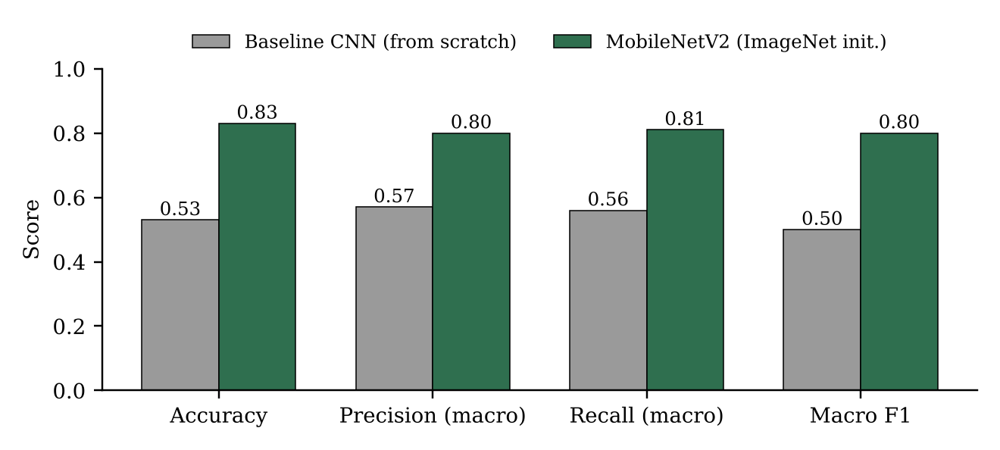
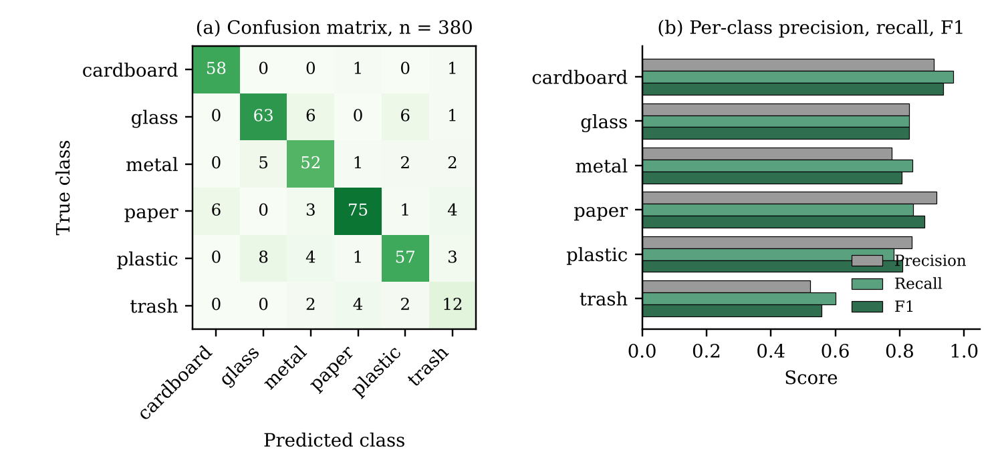

<div align="center">

# ♻️ RecycleBin

### Transfer learning for AI-powered household waste classification

*DTSC 5082, Seminar in Research and Research Methodology, University of North Texas*

</div>

---

## Overview

People often know *what* an item is but not *which bin* it belongs in, and wrong sorting contaminates recycling.
**RecycleBin** explores image classification as a first step toward accessible disposal guidance: take a photo of an
item, predict its material, and turn the prediction into a suggestion.

This repository contains the code, results, and figures for the paper
**"Data-Driven Evaluation of Transfer Learning for AI-Powered Household Waste Classification"**.

> **Research question:** Can transfer learning classify common household waste accurately enough to support useful disposal guidance?

The project compares:

| Model | Description |
|---|---|
| **Baseline CNN** | Convolutional network trained from scratch |
| **MobileNetV2** | ImageNet-pretrained backbone → global average pooling → 6-way softmax |

Six classes: `cardboard` · `glass` · `metal` · `paper` · `plastic` · `trash`

## Key results

Held-out TrashNet test set (n = 380):

| Metric | Baseline CNN | MobileNetV2 | Change |
|---|:---:|:---:|:---:|
| Accuracy | 53% | **83%** (317/380) | +30 pts |
| Precision (macro) | 0.57 | **0.80** | +0.23 |
| Recall (macro) | 0.56 | **0.81** | +0.25 |
| Macro F1 | 0.50 | **0.80** | +0.30 |
| Error rate | 47% | **17%** | −30 pts |

95% Wilson confidence intervals: MobileNetV2 **79.4–86.8%**, baseline **47.9–57.9%** (baseline count approximated as 201/380).

<p align="center">
  
</p>

### Where the model struggles

| Class | Test images | Precision | Recall | F1 |
|---|:---:|:---:|:---:|:---:|
| Cardboard | 60 | 0.91 | 0.97 | 0.94 |
| Paper | 89 | 0.91 | 0.84 | 0.88 |
| Glass | 76 | 0.83 | 0.83 | 0.83 |
| Metal | 62 | 0.78 | 0.84 | 0.81 |
| Plastic | 73 | 0.84 | 0.78 | 0.81 |
| Trash | 20 | 0.52 | 0.60 | 0.56 |

Confusions among **glass, metal, and plastic** account for 31 of the 63 test errors (about 49%), and the small, heterogeneous
**trash** class is the weakest.

<p align="center">
  
</p>

### Real-world check (TACO)

A 12-image spot-check on [TACO](https://github.com/pedropro/TACO) photos was used to probe behavior outside the benchmark.

> ⚠️ **Open item:** the presentation text reports **50%** (6/12), but the labelled photo panel shows **2 of 12** correct (≈17%).
> With only 12 images (nine of them plastic) this is exploratory evidence, not a reliable accuracy estimate.
> Re-run `taco_eval` to get the verified number (see [`results/README.md`](results/README.md)).

## Repository structure

```
recyclebin/
├── configs/config.yaml        # seed, split, image size, hyperparameters
├── data/README.md             # how to get TrashNet and TACO, label-mapping template
├── src/recyclebin/
│   ├── data.py                # stratified split (saved to CSV) + tf.data pipeline
│   ├── models.py              # baseline CNN and MobileNetV2
│   ├── train.py               # training
│   ├── evaluate.py            # metrics, confusion matrix, per-image predictions
│   ├── taco_eval.py           # real-world spot-check
│   ├── stats.py               # Wilson CIs, z-test, paired McNemar test
│   └── figures.py             # regenerate paper figures
├── results/                   # reported values + figures (new runs are written here too)
├── tests/                     # unit tests for the statistics helpers
├── docs/                      # the paper (Word draft)
├── requirements.txt
└── LICENSE
```

## Quick start

### 1. Install

```bash
git clone https://github.com/<your-username>/recyclebin.git
cd recyclebin
python -m venv .venv
source .venv/bin/activate        # Windows: .venv\Scripts\activate
pip install -r requirements.txt
pip install -e .
```

### 2. Get the data

Datasets are not stored in this repository. Follow [`data/README.md`](data/README.md):

- **TrashNet** (2,527 images): <https://github.com/garythung/trashnet>
- **TACO** (real-world litter): <https://github.com/pedropro/TACO>

### 3. Train and evaluate

```bash
python -m recyclebin.train    --model baseline
python -m recyclebin.train    --model mobilenetv2
python -m recyclebin.evaluate --model baseline
python -m recyclebin.evaluate --model mobilenetv2
```

Outputs per model go to `results/<model>/`: `predictions.csv`, `metrics.json`, `confusion_matrix.csv`,
`classification_report.txt`.

### 4. Real-world spot-check

```bash
python -m recyclebin.taco_eval --model mobilenetv2 --csv data/taco_spotcheck.csv
```

### 5. Statistics and figures

```bash
python -m recyclebin.stats ci 317 380                       # Wilson 95% CI
python -m recyclebin.stats compare 317 380 201 380          # two-proportion z-test
python -m recyclebin.stats mcnemar results/baseline/predictions.csv results/mobilenetv2/predictions.csv
python -m recyclebin.figures                                # rebuild figures (no TensorFlow needed)
```

## Evaluation approach

Accuracy alone can hide uneven class performance, especially with imbalanced classes (TrashNet: trash = 137 images vs paper = 594).
The analysis therefore reports **accuracy, precision, recall, Macro F1, a confusion matrix, per-class results, and confidence
intervals**, and treats the TACO check as exploratory rather than as formal external validation.

## Reproducibility checklist

`configs/config.yaml` contains **placeholder defaults** marked `CONFIRM`. Copy the exact values from the original notebook before
citing this repository as the source of the paper's numbers:

- [ ] random seed and train/validation/test proportions (a 15% test fraction gives 380 test images)
- [ ] image size, batch size, augmentation
- [ ] baseline CNN architecture (`models.py::build_baseline_cnn` is a generic example)
- [ ] MobileNetV2 frozen vs fine-tuned layers, optimizer, learning rate, epochs, early stopping
- [ ] TACO image selection and TACO → six-class label mapping
- [ ] run once and confirm the metrics match the paper

The `results/reported_*` files are transcribed from the team presentation and let you regenerate the paper's tables and figures
without retraining.

## Limitations

- Single data split and single training run; no variability across random seeds.
- TrashNet photos are single objects on plain backgrounds, and near-duplicate images may cross partitions if the split is not grouped by object.
- The `trash` class has only 20 test images, so its metrics are uncertain.
- The TACO spot-check is tiny, class-imbalanced, and needs a documented label mapping.
- Predicting a material class is not the same as giving the correct local disposal decision.

## Responsible use

The model predicts a **material category**, not a local recycling rule. Disposal guidance depends on municipal policy and on an item's
condition or mixed composition, so output should be shown with a confidence level and combined with location-specific rules. If deployed
with a camera, process images on-device where possible and avoid storing user photos by default. Respect each dataset's terms of use.

## Roadmap

- [ ] Add ResNet for a three-way model comparison
- [ ] Expand real-world testing well beyond 12 images (TACO, RealWaste)
- [ ] Calibrate confidence scores and flag low-confidence predictions
- [ ] Grad-CAM explanations to check for background reliance
- [ ] Prototype: photo → material → disposal guidance with local rules

## References

1. M. Yang and G. Thung, "Classification of Trash for Recyclability Status," Stanford CS229 Project Report, 2016.
2. P. F. Proença and P. Simões, "TACO: Trash Annotations in Context for Litter Detection," arXiv:2003.06975, 2020.
3. M. Sandler et al., "MobileNetV2: Inverted Residuals and Linear Bottlenecks," CVPR, 2018.

## License

Code is released under the [MIT License](LICENSE). Datasets retain their own licenses.
